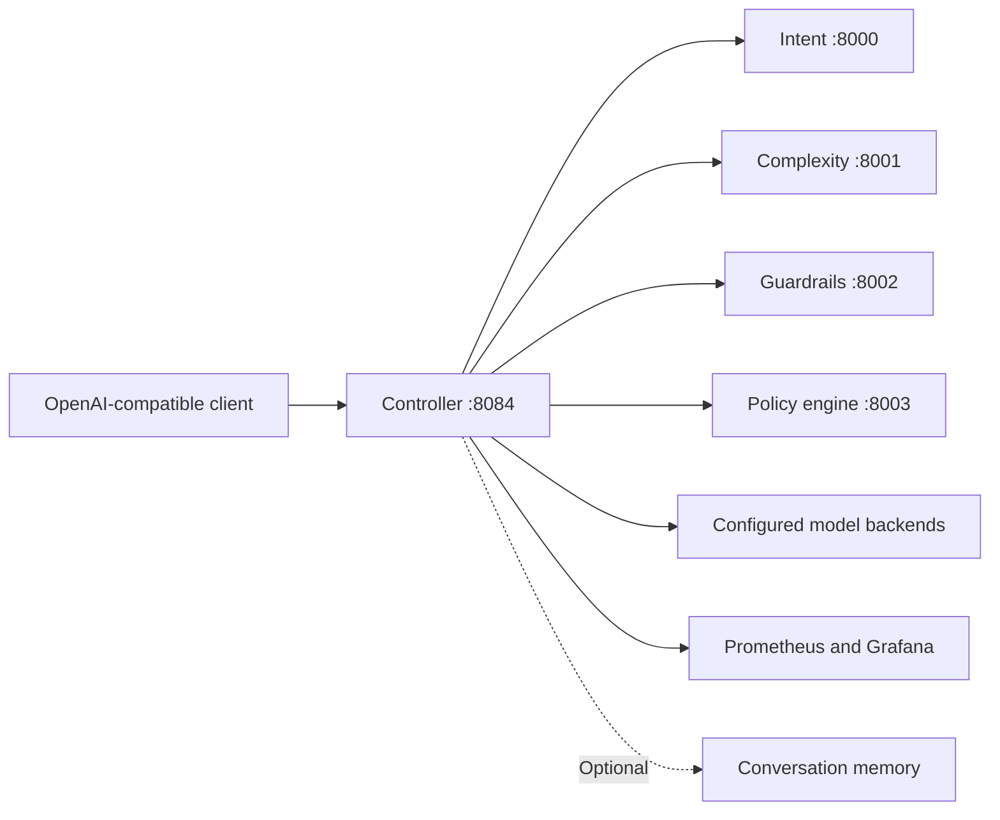

# ReRout

**Route LLM requests by intent, complexity, and cost through one API.**

ReRout is a configurable routing service with an OpenAI-compatible chat-completions endpoint. Its pipeline classifies a request, checks guardrails, selects a model under a routing policy, and records usage and estimated cost. The source and API internals retain the earlier name **RouteLLM**.

[Quick start](#quick-start) · [Send a request](#send-a-request) · [Architecture](#architecture) · [Configuration reference](docs/CONFIGURATION.md)

## Capabilities

- **Explicit or automatic routing:** address a provider/model directly, use an alias, or let a policy decide.
- **Multiple backends:** configure OpenAI, Anthropic, OpenRouter, Ollama, or a mock backend.
- **Streaming responses:** forward chat-completion output through server-sent events.
- **Request analysis:** combine intent classification, complexity estimation, and PII guardrails.
- **Observability:** inspect Prometheus metrics, estimated token costs, and Grafana dashboards.
- **Optional conversation memory:** configure a bounded token stack with an in-memory or Redis backend.

This is a development implementation. Classifiers can use heuristics when ONNX assets are unavailable; integrations and policies should be evaluated on your workload before deployment.

## Architecture



## Quick start

Requirements: **Docker Compose** and provider credentials for live requests. Local Python development uses the pinned dependencies in [`requirements.txt`](requirements.txt); Python 3.11 is a suitable starting point.

```bash
git clone https://github.com/ReRout/ReRout.git
cd ReRout
cp config.example.yaml config.yaml
touch .env
```

Set the provider keys you need in `.env`, such as `OPENAI_API_KEY` and `ANTHROPIC_API_KEY`. Review [`config.example.yaml`](config.example.yaml) to choose backends, aliases, classifier endpoints, and memory settings. Then start the stack:

```bash
docker compose up --build -d
curl --fail http://localhost:8084/health
```

Open the [API documentation](http://localhost:8084/docs) or [built-in playground](http://localhost:8084/playground). The Compose stack also exposes Prometheus on `9090` and Grafana on `3000`; replace its development Grafana credentials before exposing it beyond your machine.

## Send a request

The example configuration includes a `demo` alias for the mock backend, so this request needs no upstream provider key:

```bash
curl --fail http://localhost:8084/v1/chat/completions \
  -H 'Content-Type: application/json' \
  -d '{"model":"demo","messages":[{"role":"user","content":"Hello from ReRout"}]}'
```

To request policy-based routing instead, send an empty model and a routing policy. This can invoke a paid provider selected by your configuration:

```bash
curl --fail http://localhost:8084/v1/chat/completions \
  -H 'Content-Type: application/json' \
  -d '{"model":"","messages":[{"role":"user","content":"Explain a binary search tree"}],"extra_body":{"routing_policy":"task_router"}}'
```

See [usage and configuration examples](docs/CONFIGURATION.md) for SDK calls, streaming, memory, and routing options. Provider model IDs and pricing change; the configured catalog and cost estimates are not guaranteed live prices.

## Development

```bash
make setup
source venv/bin/activate
make test
```

`make run` starts only the controller; its configured classification, guardrail, and policy services must be reachable. Docker Compose is the simpler path to the complete stack.

The optional assistant-ui frontend lives in [`chat-ui`](chat-ui). With the backend running:

```bash
cd chat-ui
npm install
npm run dev
```

Open [localhost:4000](http://localhost:4000). See the [chat UI guide](chat-ui/README.md) and [monitoring guide](monitoring/README.md) for their configuration.

## Project map

| Location | Responsibility |
| --- | --- |
| [`controller`](controller) | API orchestration, provider adapters, cost tracking, and memory. |
| [`classifiers`](classifiers) | Intent and complexity services. |
| [`guardrails`](guardrails) | Request checking. |
| [`policy_engine`](policy_engine) | Model-selection policies. |
| [`tests`](tests) | Local automated checks. |
| [`examples`](examples) | Integration examples. |

Report problems through [GitHub Issues](https://github.com/ReRout/ReRout/issues).
